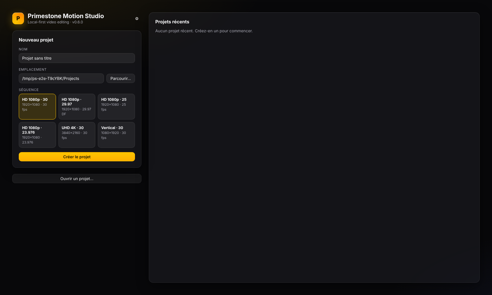
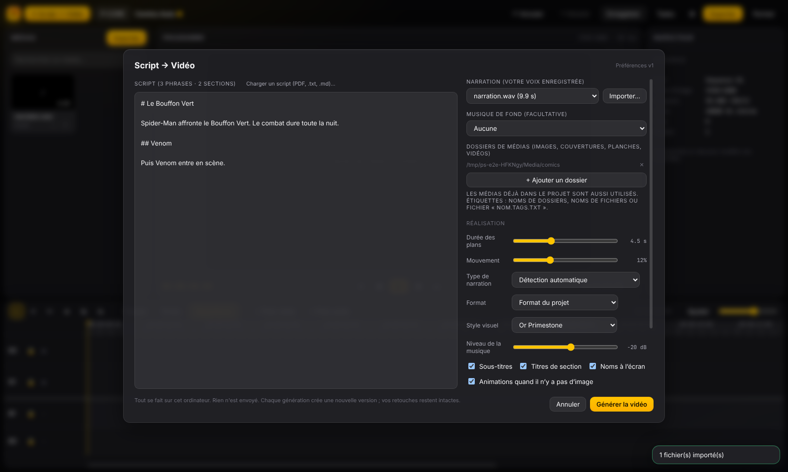
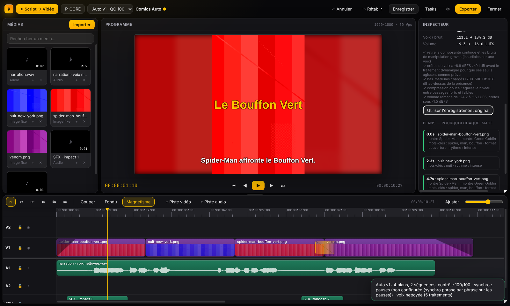
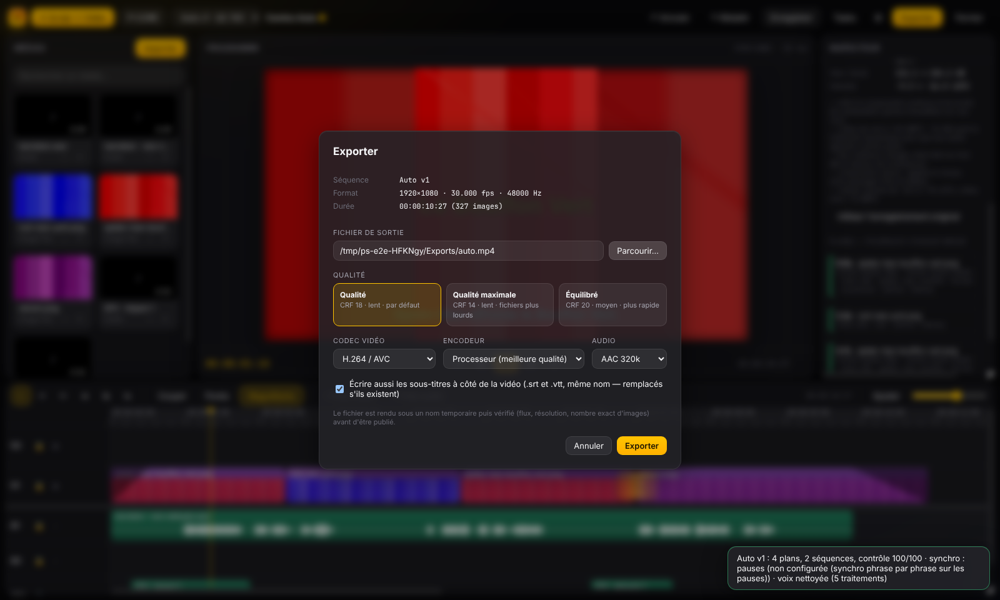

# Démarrage rapide — votre première vidéo en 8 étapes

Il vous faut : Primestone Motion Studio installé (voir `INSTALLATION_WINDOWS.md`), **votre script**
(PDF, Word exporté en PDF, `.txt` ou `.md`) et **votre narration** enregistrée (WAV de préférence ;
MP3 accepté). Les images sont facultatives : sans elles, Primestone crée des animations.

Parcours : **Créer un projet → importer la narration → charger le script → ajouter des médias →
générer → prévisualiser → corriger → exporter.**

---

## 1. Créer un projet

1. Sur l'écran d'accueil, tapez un nom (ex. `Midnight Spider-Man`).
2. Choisissez le dossier où ranger le projet.
3. Choisissez le format : **HD 1080p · 30** (YouTube) ou **Vertical · 30** (Shorts/TikTok/Reels).
4. Cliquez sur **Créer le projet**.

## 2. Importer votre narration

1. Cliquez sur **Importer** (en haut de la bibliothèque de médias).
2. Sélectionnez votre fichier de voix. Il apparaît dans la bibliothèque.
   Votre fichier d'origine ne sera **jamais modifié**.

## 3. Ouvrir Script → Vidéo et charger le script

1. Cliquez sur **✦ Script → Vidéo**.
2. Cliquez sur **Charger un script (PDF, .txt, .md)…** et choisissez votre script.
   Le texte converti s'affiche : les indications (`VISUELS`, `Source(s)`, `Texte : « … »`,
   bibliographie, fiche de rigueur…) sont reconnues et **ne seront pas lues comme narration**.
   Relisez-le rapidement ; vous pouvez le corriger directement dans la zone de texte.
3. Vérifiez que votre narration est sélectionnée dans la liste **Narration (votre voix enregistrée)**.

> **Pas de script ?** Laissez la zone de texte vide : si la transcription locale est activée
> (**Réglages → Transcription locale**), votre narration est transcrite et sert de script
> (voir `GUIDE_UTILISATEUR.md`, « Sans script »).

## 4. Ajouter vos images (facultatif)

1. Cliquez sur **+ Ajouter un dossier** et choisissez le dossier contenant vos couvertures et planches.
2. Astuce : nommez vos fichiers avec le titre, le numéro et l'année, par exemple
   `Batman 676 (2008) cover.jpg`. Primestone vérifie alors que l'image correspond bien au numéro
   cité dans le script et **n'utilise jamais une œuvre homonyme** (ex. *Secret Wars* 2015 au lieu
   de 1984).
3. Une musique ? Importez-la (**Importer**) puis choisissez-la dans **Musique de fond (facultative)** : elle sera baissée automatiquement sous la
   voix.

## 5. Générer la vidéo

1. Laissez cochées les options par défaut (sous-titres, titres de section, animations quand il
   n'y a pas d'image, **Nettoyer la voix (bruit, ronflement, volume)**, **Effets sonores**).
2. Cliquez sur **Générer la vidéo**. La progression s'affiche (analyse de la voix, nettoyage,
   synchronisation, montage, rendu des animations, contrôle qualité).
3. Une nouvelle version **Auto v1** apparaît dans la timeline. Vos versions précédentes restent
   disponibles.

## 6. Prévisualiser

- **Espace** : lecture / pause. **Début** (`Home`) : revenir au début.
- Le panneau de droite (**Version générée · v1**) explique chaque choix : *pourquoi* chaque image a été
  choisie, la note de contrôle qualité et les problèmes détectés (cliquez sur un problème pour y
  aller).

## 7. Corriger

- Cliquez sur un plan dans la timeline pour le modifier dans l'inspecteur (position, zoom,
  durée, fondus).
- Une animation (carte personnage, frise, titre) se modifie dans l'inspecteur : changez le texte,
  elle est recalculée.
- Section **Voix** : comparez les mesures avant/après et, si vous préférez, cliquez sur
  **Utiliser l'enregistrement original**.
- **Ctrl+Z** annule toute modification.
- **Apprendre de mes retouches** : Primestone retient vos préférences (rythme, mouvements, transitions,
  musique) pour les prochaines vidéos — c'est réversible.

## 8. Exporter

1. Cliquez sur **Exporter**.
2. **Parcourir…** : choisissez le nom et l'emplacement du fichier vidéo.
3. Laissez cochée l'option des sous-titres : des fichiers `.srt` et `.vtt` sont créés à côté de la
   vidéo (utiles pour YouTube).
4. Cliquez sur **Exporter**. Le fichier est vérifié automatiquement (durée, image, son) avant d'être
   publié dans le dossier choisi.

C'est terminé. Pensez à **Ctrl+S** pour enregistrer le projet (il est aussi sauvegardé
automatiquement).

Pour aller plus loin : `GUIDE_UTILISATEUR.md`.
