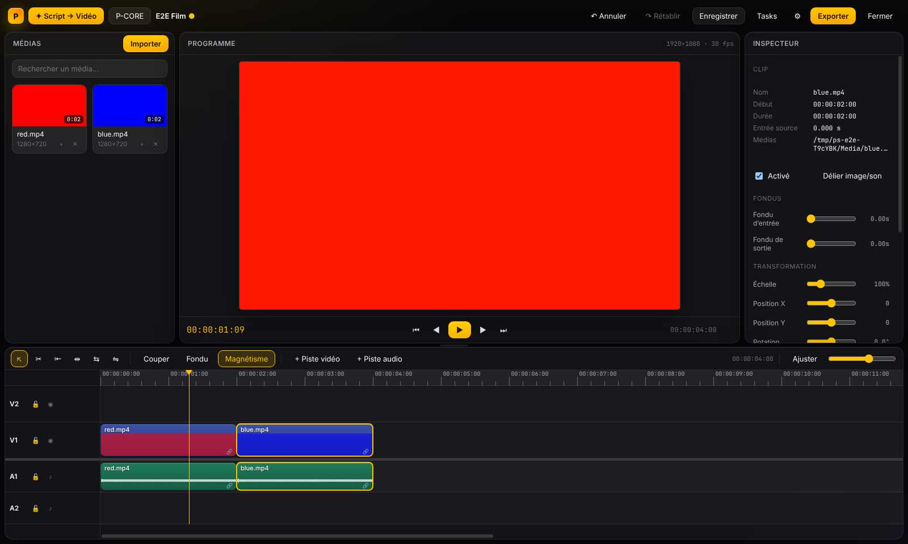
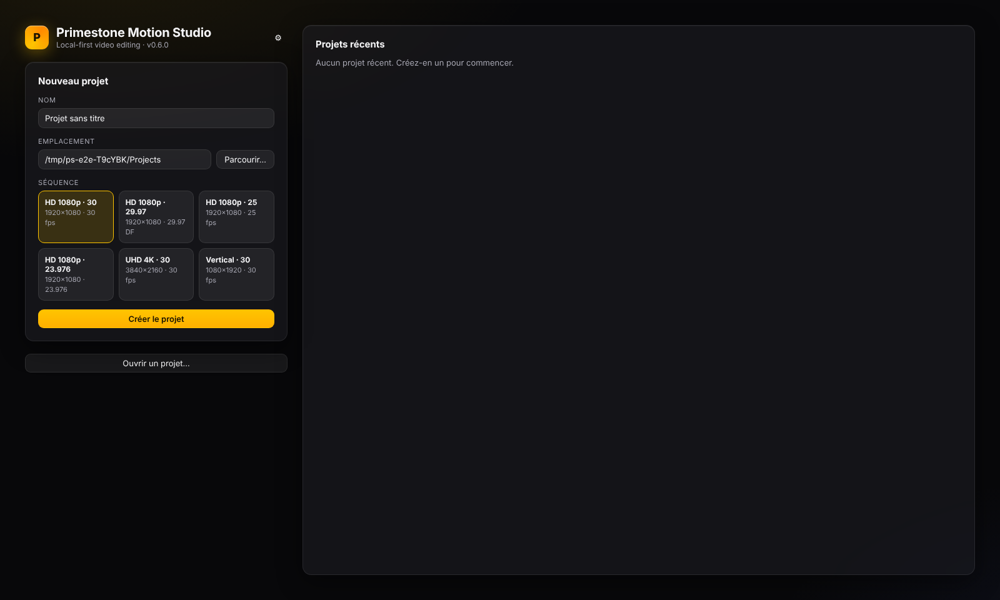
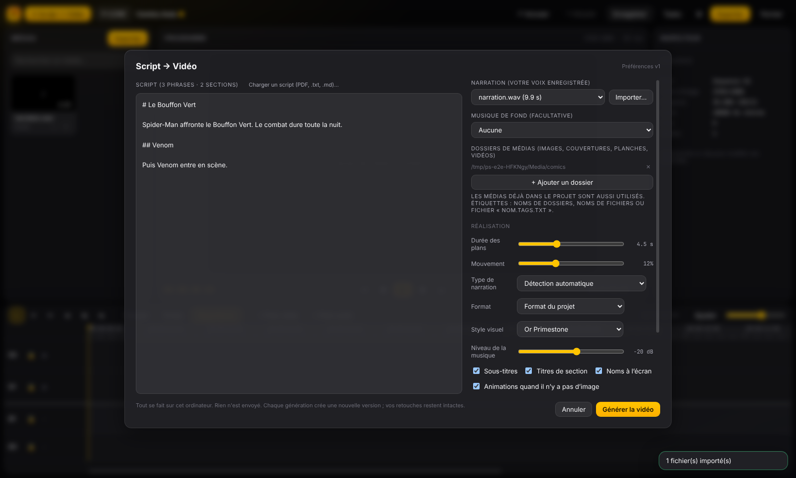
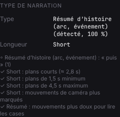
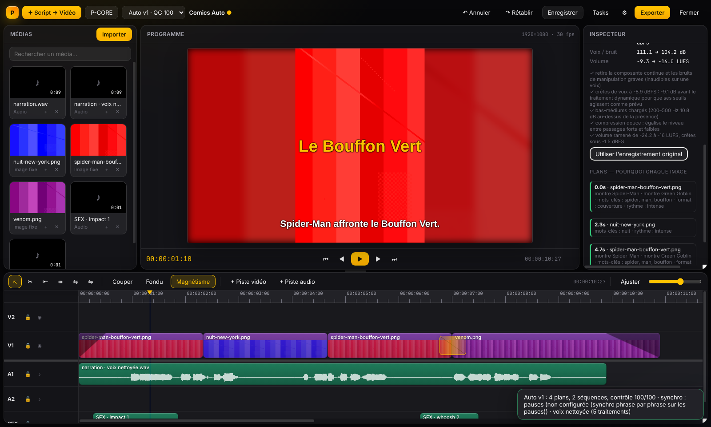
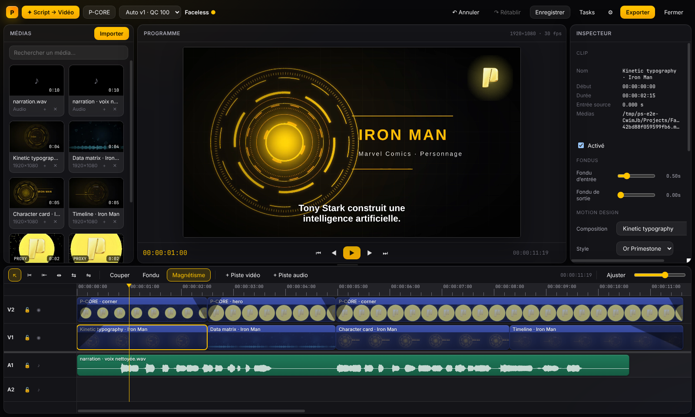
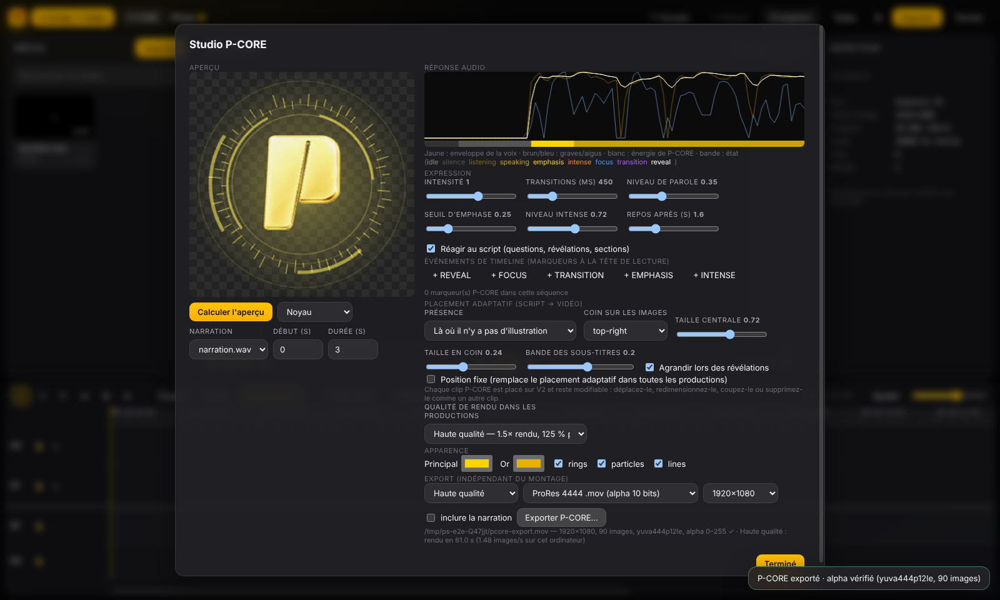
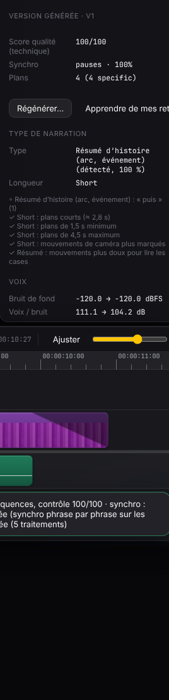
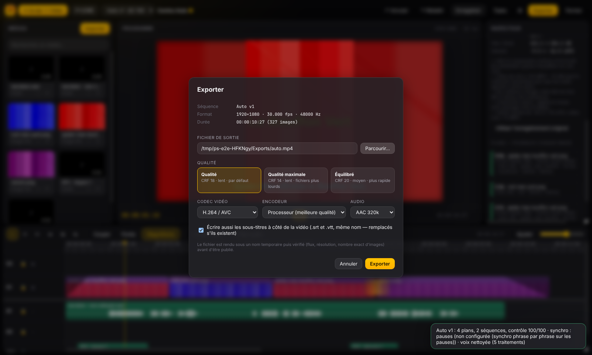

# Guide d'utilisation — Primestone Motion Studio 0.7

Ce guide décrit **uniquement ce que le logiciel fait réellement** dans la version 0.6. Les fonctions
pas encore disponibles sont signalées par ⛔. Les noms des boutons sont indiqués en **gras**. Toutes les captures proviennent de l'application (générées par ses tests
automatiques).

Premiers pas en 8 étapes : `DEMARRAGE_RAPIDE.md`. Installation : `INSTALLATION_WINDOWS.md`.

---

## 1. Découvrir l'interface

- **En haut** : nom du projet (un point indique des changements non enregistrés), **Undo / Redo**,
  **Enregistrer**, sélecteur de version (**Séquences / versions générées**), **✦ Script → Vidéo**,
  **P-CORE**, **Exporter**, ⚙ **Réglages**.
- **À gauche** : la bibliothèque de médias (**Importer**).
- **Au centre** : le lecteur (aperçu en direct, sous-titres compris).
- **À droite** : l'inspecteur (réglages du clip sélectionné, ou rapport de génération).
- **En bas** : la timeline multipiste (V = vidéo, A = audio).

Raccourcis : **Espace** lecture/pause · **J / K / L** arrière / pause / avant · **←/→** image par
image · **Home / End** début / fin · **S** couper à la tête de lecture · **M** marqueur ·
**Suppr** supprimer · **Ctrl+Z / Ctrl+Shift+Z** annuler / rétablir · **Ctrl+S** enregistrer ·
**Ctrl+D** fondu enchaîné · **+ / −** zoom · outils **V** sélection, **C** lame, **B** ripple,
**N** roll, **Y** slip, **U** slide.

## 2. Créer un projet

Nom, dossier, format (**HD 1080p · 30**, **UHD 4K · 30**, **Vertical · 30**…) puis
**Créer le projet**. Les projets récents s'affichent sur l'accueil ; un fichier `.psproj` s'ouvre
aussi par double-clic dans l'Explorateur.

## 3. Importer un script

**✦ Script → Vidéo → Load script (PDF, .txt, .md)…** Vos scripts de production PDF sont convertis :
- titres minutés (`0:00 - 1:35 | INTRODUCTION`) → sections ;
- `VISUELS —`, `Montage :` → indications visuelles ; `Texte : « … »` → texte à l'écran ;
- `Source(s) comics :` → références (utilisées pour choisir les images, jamais lues) ;
- bibliographie, `DOSSIER SOURCE`, `FICHE DE RIGUEUR`, `RÉALISATION`, annexes → **ignorés pour la
  narration** (vérifié sur vos 5 scripts : aucune phrase de narration perdue).

Vous pouvez aussi écrire directement dans la zone de texte, avec des balises facultatives :
`[VISUEL: …]`, `[ECRAN: …]`, `[SOURCE: …]`, `[SON: …]`, `[NOTE: …]`, et `## Titre` pour une section.

### Sans script : la narration sert de script

Vous n'avez pas de script écrit ? Laissez la zone de texte vide. Si la transcription locale est
activée (**Réglages → Transcription locale**), Primestone transcrit votre narration sur votre
ordinateur puis reconstruit un script :
- les **phrases** à partir de la ponctuation et des pauses ;
- les **paragraphes** à partir des pauses plus longues ;
- les **sections** à partir des très longues pauses ou des tournures parlées (« passons à »,
  « numéro 5 », « pour conclure »…), titrées avec les noms dont la section parle le plus ;
- les **prises ratées** en fin d'enregistrement (jurons, « je recommence »…) sont détectées, retirées
  du montage et signalées.

Après la génération, le script reconstruit est enregistré dans **Script → Vidéo** : rouvrez le
panneau pour le relire, le corriger et régénérer. Testé sur votre narration *Midnight Spider-Man*
(6 min) : 53 phrases, 2 sections, prise ratée finale retirée, contrôle 100/100.

## 4. Importer une narration

**Importer** → votre fichier (WAV recommandé ; MP3, M4A, FLAC acceptés). Choisissez-le ensuite dans
**Narration (votre voix enregistrée)**. Le fichier d'origine n'est jamais modifié.

Si votre enregistrement se termine par une prise ratée ou des commentaires hors script, Primestone
la détecte, la laisse hors du montage et le signale dans le contrôle qualité (réversible : allongez
le clip de narration pour la récupérer). Mesuré sur votre narration réelle *Midnight Spider-Man*.

## 5. Ajouter couvertures et illustrations

**+ Ajouter un dossier** dans Script → Vidéo (ou **Importer** pour des fichiers isolés). Primestone choisit
les images d'après leur **nom de fichier** et leurs étiquettes :
- nommez-les avec le personnage, le titre, le numéro et l'année : `Venom.jpg`,
  `Secret Wars #1 (1984).jpg`, `Batman 676 (2008) cover.jpg` ;
- une image d'un autre numéro, d'un autre volume ou d'une autre décennie d'une série du même nom
  est **exclue** pour le passage qui cite une référence précise ;
- une planche verticale est lue **case par case** quand les cases sont détectées.

Le rapport indique toujours « lu dans le nom du fichier, non authentifié » : Primestone ne prétend
jamais avoir authentifié une image.

### Formats de comics reconnus automatiquement

À l'import, chaque image est analysée (proportions, cases détectées, couleurs) :

| Format détecté | Comment il est montré |
|---|---|
| **Couverture** | zoom avant lent |
| **Planche** (plusieurs cases) | lecture case par case |
| **Double page** (large, 3 cases ou plus) | lecture case par case sur toute la double page |
| **Webtoon** (bande très haute) | lecture case par case vers le bas, sinon défilement vertical |
| **Manga** (planche en noir et blanc, ou nom contenant « manga »/« chapitre ») | lecture **de droite à gauche** |
| **Illustration** | mouvement de caméra classique |

Le format détecté apparaît dans la raison de chaque plan (« format : planche manga, lecture de
droite à gauche · lue case par case (4 cases) »).

## 6. Sources de recherche Internet ⛔

**Pas encore disponible.** Aucun fournisseur d'images en ligne n'est connecté dans la version 0.6 :
Primestone n'envoie rien sur Internet. Quand une image manque, il crée une animation (§ 10) ou
vous signale le manque. Les fournisseurs (désactivés par défaut, avec votre accord explicite et
vérification des licences) sont prévus dans une prochaine version.

## 7. Générer automatiquement une vidéo

Dans **✦ Script → Vidéo** :
- **Format** : format du projet, ou **16:9**, **9:16** (Shorts/TikTok/Reels), **1:1**, **4:5**.
  Chaque format produit une **nouvelle version** recomposée (cadrages, animations, sous-titres,
  position de P-CORE) ; les autres versions sont conservées.
- **Durée des plans**, **Mouvement**, **Style visuel**, **Niveau de la musique** ;
- cases : sous-titres, titres de section, noms à l'écran, animations quand il n'y a pas d'image,
  lecture case par case, **Nettoyer la voix (bruit, ronflement, volume)**, **Effets sonores**.

Cliquez sur **Générer la vidéo**. Les étapes s'affichent : analyse de la narration, nettoyage de la
voix, synchronisation, indexation des médias, montage, rendu des animations et de P-CORE, contrôle
qualité.

### Type de narration détecté

Primestone lit le script (ou la narration transcrite) et reconnaît le type de vidéo : **classement /
top**, **versus**, **origine / biographie**, **résumé d'histoire**, **théorie**, **analyse /
explication**, **actualité**, ainsi que la longueur (**Short** ≤ 3 min, vidéo standard,
**documentaire** ≥ 30 min). La réalisation s'y adapte, par exemple :
- **Short** : plans courts (≈ 2,8 s), coupes franches, mouvements plus marqués ;
- **résumé d'histoire** : plans plus longs, lecture des planches case par case, mouvements doux ;
- **classement** : un carton « N°5 », « N°4 »… quand le narrateur annonce une entrée ;
- **documentaire** : plans plus longs et plus de fondus enchaînés.

Le choix **Type de narration** permet de forcer un type, et la case **Adapter la réalisation au type
de narration** de désactiver ces ajustements. Vos préférences enregistrées ne sont jamais modifiées
par cette adaptation : elle s'applique à la génération en cours. L'inspecteur affiche le type
détecté, sa confiance, les indices trouvés et chaque réglage modifié.

### Resserrer les longues pauses (facultatif)

La case **Resserrer les longues pauses** (idée reprise du logiciel libre auto-editor) raccourcit les
pauses de plus de 0,75 s à 0,45 s, dans une copie de la narration : votre fichier reste intact, et
texte, sous-titres et images sont recalculés pour rester synchronisés. Le contrôle qualité indique
combien de secondes ont été retirées.

## 8. Comprendre les décisions du moteur

Sélectionnez la version générée : l'inspecteur affiche **Version générée · vN** :
- **Score qualité (technique)** : note de contrôle *technique* (trous, plans trop courts ou trop longs, répétitions,
  droits, sous-titres trop rapides, synchronisation). Ce n'est **pas** une note artistique ;
- **Synchro** : *word-level* (transcription) ou *pauses*, avec un pourcentage de confiance ;
- **Plans — pourquoi chaque image** : pour chaque plan, l'image retenue et la raison (« montre Venom »,
  « même numéro : Secret Wars #1 (1984) », « aucune correspondance précise »…). Cliquez pour y aller.

## 9. Modifier la timeline

- Sélectionner, déplacer, raccourcir (bords du clip), couper (**S**), supprimer.
- Outils **ripple / roll / slip / slide** (touches B, N, Y, U) ; magnétisme (**Magnétisme**).
- Inspecteur d'un clip : position, échelle, rotation, opacité, fondus, mouvement de caméra.
- Transitions : **Ctrl+D** ajoute un fondu enchaîné au raccord le plus proche.
- Tout est annulable (**Ctrl+Z**) ; le montage généré reste entièrement modifiable.

## 10. Modifier les compositions (cartes, frises, hologrammes) et P-CORE

Sélectionnez un plan créé par Primestone : l'inspecteur permet de changer le type de composition
(carte personnage, frise, typographie, hologramme, matrice de données, cosmique…), le titre et le
sous-titre ; la composition est recalculée.

**P-CORE** (présence animée construite sur le logo Primestone) :

- Il occupe sa propre piste (V2) : déplacez-le, redimensionnez-le, supprimez-le comme un clip.
- **P-CORE** (bouton du haut) ouvre le studio : aperçu sur fond transparent, réaction à votre voix,
  sensibilité, marqueurs (**REVEAL**, **FOCUS**…), placement, apparence, export transparent.
- Placement par défaut : grand et central quand il n'y a pas d'image, discret dans un coin ou une
  bande libre sinon, plus grand lors des révélations.

## 11. Nettoyer la voix

**Nettoyer la voix (bruit, ronflement, volume)** (activé par défaut) mesure votre enregistrement et n'applique que ce qui est
utile : filtre de grondement, suppression du ronflement 50/60 Hz, réduction de bruit apprise dans
une de vos pauses, pré-gain, dé-esseur et égalisation si mesurés, compression douce, volume final
(−16 LUFS, crêtes sous −1,5 dBFS). La synchronisation est préservée (le retard des filtres est
mesuré puis compensé).

Dans l'inspecteur, section **Voix** : mesures avant/après, liste des traitements avec leur raison,
et **Utiliser l'enregistrement original** (annulable). Mesuré sur votre narration réelle : −35,5 → −16,1
LUFS, sibilance réduite de 9 dB, aucune saturation, 13 s de traitement pour 6 min.

## 12. Musique et effets sonores

- **Musique de fond (facultative)** : la musique est placée sous toute la vidéo, à **Niveau de la musique** sous la
  voix, et **baissée automatiquement pendant la narration** (ducking). Réglage : sélectionnez le
  clip de musique → **Baisser cette piste sous** / profondeur.
- **Effets sonores** : sons générés localement (whoosh aux changements de section, impact sous les
  titres) sur la piste **SFX**. Supprimez-les ou baissez la piste ; **Apprendre de mes retouches** s'en
  souvient.
- ⛔ Le choix automatique d'une musique dans votre bibliothèque selon l'ambiance n'est pas encore
  disponible : vous choisissez le morceau.

## 13. Sous-titres

- Créés automatiquement à partir du script, synchronisés sur la voix (mot à mot avec la
  transcription locale), coupés en lignes lisibles, placés dans la zone de sécurité du format.
- Corrigez une phrase dans le script puis régénérez, ou modifiez le sous-titre dans la timeline.
- À l'export : incrustés dans la vidéo **et** écrits en `.srt` et `.vtt` à côté (option cochée par
  défaut).
- ⛔ Mise en évidence mot par mot (style karaoké) : pas encore disponible.

## 14. Format vertical et autres formats

Script → Vidéo → **Format** → **9:16** (ou 1:1, 4:5) → **Générer la vidéo**. Une nouvelle version est
recomposée pour ce cadre ; basculez entre les versions avec le sélecteur de version.

## 15. Commandes vocales ⛔

**Pas encore disponibles** dans la version 0.6. Toutes les modifications se font à la souris et au
clavier.

## 16. Prévisualiser

Espace pour lire ; l'aperçu affiche images, animations, sous-titres et P-CORE. Pour les vidéos très
chargées, l'aperçu peut baisser en fluidité ; l'export, lui, est toujours calculé image par image.

## 17. Contrôle qualité

La liste **Contrôle qualité** (inspecteur) signale : trous noirs, images manquantes, plans trop
courts ou trop longs, même image deux fois de suite, droits non vérifiés, sous-titres trop rapides,
synchronisation approximative, **paroles hors script**. Cliquez sur un problème pour aller à
l'endroit concerné. Rappel : c'est un contrôle technique, pas un jugement artistique.

## 18. Exporter

**Exporter → Parcourir…** (nom et dossier) → réglages (MP4/MOV/MKV, H.264/H.265, qualité, encodeur
**Processeur** ou **Matériel si vérifié**, audio AAC) → **Exporter**. La vidéo est rendue sous un nom
temporaire puis **vérifiée** (flux, résolution, nombre exact d'images) avant d'être publiée. Les
vidéos longues sont rendues par segments : si l'export est interrompu, le relancer reprend là où il
s'était arrêté.

## 19. Sauvegarde et restauration

- **Ctrl+S** enregistre. Une **sauvegarde automatique** est faite en continu.
- Après un plantage : rouvrez le projet, **Récupérer les modifications non enregistrées ?** → **Récupérer**.
- Le dossier `Backups` du projet conserve les versions précédentes du fichier projet.
- Média déplacé : badge **HORS LIGNE** → **Localiser…**.

## 20. Versions

Chaque génération crée une version (**Auto v1**, **Auto v2 · 9:16**…) sans toucher aux autres. Le
sélecteur de version permet de passer de l'une à l'autre et de comparer.
⛔ La comparaison chiffrée automatique entre deux versions n'est pas encore disponible.

## 21. Fonctionnement hors ligne

Tout fonctionne sans Internet après l'installation : lecture des scripts, analyse et nettoyage de la
voix, transcription locale (si installée), montage, animations, P-CORE, export. Aucune donnée n'est
envoyée. Aucun modèle n'est téléchargé automatiquement.

## 22. Apprentissage de vos préférences

- **Apprendre de mes retouches** (inspecteur de la version générée) : Primestone compare votre version
  retouchée à ce qu'il avait généré (durée des plans, mouvements, transitions, niveau de musique,
  effets…) et ajuste ses **paramètres** de production. Le message indique exactement ce qui a changé.
- **Script → Vidéo → Historique des préférences** : chaque ajustement est une version ; **Restaurer** revient
  à une version précédente.
- Ce n'est **pas** un entraînement de modèle d'IA : seuls des paramètres de montage sont adaptés,
  de façon visible et réversible.
